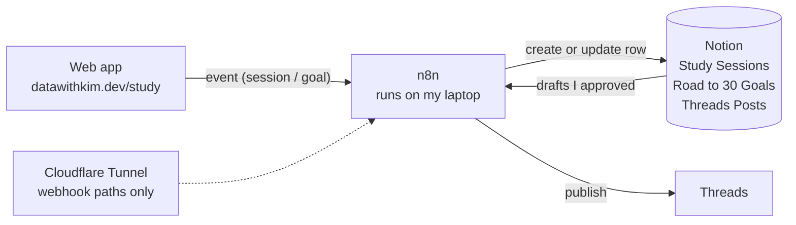

# Road to 30 Tracker

A personal study and goals pipeline: a web app to focus and log study, n8n to move the data, Notion as the database, and Threads to share progress in public.

**Live app:** [datawithkim.dev/study](https://datawithkim.dev/study/)



## Why

I'm working toward a set of goals before I turn 30: a data engineering role, certifications, languages, and more. I wanted one place to focus, a real record of the hours I put in, and a habit of sharing the journey. I also wanted to build it the way a data engineer would: events, a pipeline, a database, and automated output.

## How it works

| Part | What it does |
| --- | --- |
| **Web app** (`/study`) | Focus timer with breaks, study log, progress charts, quotes, background sounds made with Web Audio, and a Road to 30 tab with goals and steps. Data is saved in the browser and every change goes into an outbox. |
| **Outbox** | Each saved session and goal change is queued and sent to n8n. If n8n can't be reached, the events wait and are retried, so nothing is lost when the laptop is off. |
| **n8n · 1 · App to Notion** | Webhook. Checks a shared key, maps the event to Notion properties, then finds the row by `App ID` and updates it, or creates it. Deletes archive the row. When a goal step is ticked, it also writes a milestone draft for Threads. |
| **n8n · 2 · Weekly recap draft** | Every Sunday at 20:00 it reads the week's sessions and all goals from Notion and writes a recap post as a Draft. |
| **n8n · 3 · Publish to Threads** | Every 15 minutes it looks for posts I set to Approved, publishes them with the Threads API, and marks them Posted with the link. |
| **Cloudflare Tunnel** | Gives the laptop's n8n a public HTTPS address, but only for `/webhook/` paths. The n8n editor is not exposed. |

**Design choices**

- **No keys on the website.** The app only knows the n8n URL and a shared key typed in by me; the Notion and Threads tokens live in n8n.
- **Idempotent writes.** Every row carries the app's own ID, so sending an event twice updates the same row instead of creating a duplicate.
- **Human in the loop.** Nothing is posted to Threads until I approve the draft in Notion.
- **Simple requests.** The app posts `text/plain` JSON, so the browser sends it without a CORS preflight; n8n allows only `https://datawithkim.dev`.

## Data model

**Event sent by the app**

```json
{ "key": "…", "type": "session", "data": { "id": "mwmak24vihoqt", "startLocal": "2026-11-18T16:18:00+01:00", "min": 40, "subject": "Data Engineering", "task": "SQL joins", "note": "", "rating": 4, "distractions": 1, "kind": "timer" } }
```

`type` is one of `session`, `session_delete`, `goal`, `goal_delete`, `pull_goals` or `ping`.

**Notion databases**

| Database | Columns |
| --- | --- |
| Study Sessions | Working on, Date, Minutes, Subject, Focus rating, Distractions, Notes, Source, Posted to Threads, App ID |
| Road to 30 Goals | Goal, Area, Target date, Steps done, Steps total, Progress (formula), Status, Steps, Linked subject, Hours target, App ID |
| Threads Posts | Post, Text, Status (Draft → Approved → Posted), Type, Created, Posted at, Threads link |

## Set it up

### 1. Notion

1. Create an internal integration at [notion.so/profile/integrations](https://www.notion.so/profile/integrations) and copy its secret.
2. Open the **Road to 30 · Study Tracker** page → `•••` → **Connections** → add the integration, so it can read and write the three databases.

### 2. n8n credentials

In n8n → **Credentials** → **New**:

| Credential type | Name | Field values |
| --- | --- | --- |
| Header Auth | Notion – Road to 30 | Name `Authorization`, Value `Bearer <your Notion secret>` |
| Query Auth | Threads – Road to 30 | Name `access_token`, Value `<your long-lived Threads token>` |

### 3. Import the workflows

Import the three files in [`n8n/`](n8n/) (**Workflows → Import from File**). Then:

- In every Notion HTTP node, choose the **Notion – Road to 30** credential. In the Threads nodes, choose **Threads – Road to 30**.
- In **1 · App to Notion → Check key & prepare**, replace `CHANGE-ME-to-a-long-random-key` with your own long random key.
- In **2 · Weekly recap draft → Write the recap**, check the two dates at the top.

### 4. Cloudflare Tunnel (so the phone can reach the laptop)

This needs the domain's DNS on Cloudflare (the free plan is enough). When you move the DNS, keep the existing GitHub Pages records so the website stays up.

```bash
# macOS: brew install cloudflared      Windows: winget install --id Cloudflare.cloudflared
cloudflared tunnel login
cloudflared tunnel create road-to-30
cloudflared tunnel route dns road-to-30 n8n.datawithkim.dev
# copy cloudflared/config.yml to ~/.cloudflared/config.yml and fill in the tunnel id, then:
cloudflared tunnel run road-to-30
```

Start n8n with `WEBHOOK_URL=https://n8n.datawithkim.dev/` so it shows the public webhook URL.
To keep both running after a restart, install them as services (`cloudflared service install`).

### 5. Connect the app

1. Activate workflow **1 · App to Notion**.
2. In the app → **Focus** → **Notion sync**, paste `https://n8n.datawithkim.dev/webhook/study-focus` and the same key, then press **Test**.
3. Press **Send everything** to copy past sessions, and **Get goals from Notion** on the Road to 30 tab to load the goals.

### 6. Threads

1. In [Meta for Developers](https://developers.facebook.com/), create an app with the **Access the Threads API** use case and the `threads_basic` and `threads_content_publish` permissions.
2. Add your Threads account as a tester and accept the invite in the Threads app (Settings → Account → Website permissions).
3. Generate a token, exchange it for a long-lived token (valid 60 days), and put it in the **Threads – Road to 30** credential.
4. Activate workflows **2** and **3**. Refresh the token before it expires:
   `GET https://graph.threads.net/refresh_access_token?grant_type=th_refresh_token&access_token=<token>`

The laptop must be on (and n8n running) for the Sunday recap and for publishing. Anything sent while it is off waits in the app's outbox.

## What I learned

_To fill in as the project grows._
